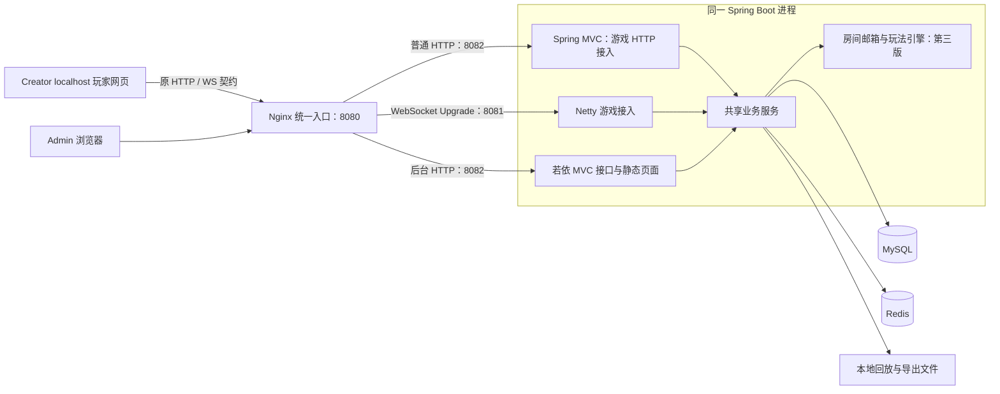

# 凉山多人棋牌游戏 Java 服务端方案

> 编制日期：2026-11-06。设计容量：初期约 1,000 人同时在线。本文为开发设计，不代表已有 Java 服务端或通过性能测试。
>
> 本次修订：确定 Jackson 3 游戏协议、官方若依 Vue 3/TypeScript Admin、统一 BOM 依赖与本地 HTTP/WS 入口；补齐游客持久凭据、永久房间 ID、异步事务和容量验证约束。同工程、分模块、同进程，按大厅 → 圈组织 → 房间与 6003 斗地主交付；Creator 除服务器地址外保持不变。
>
> 阅读顺序：[功能模块说明书](../Client/功能模块说明书.md) → 本文 → [前端字段与源码证据](前端字段与源码证据.md) → [机器可读协议索引](protocol-evidence.json)。字段索引用于开发定位，不是已经验证的服务端协议规范。

## 1. 结论与依据

采用 **Java 21 LTS + 官方 RuoYi-Vue 的 Spring Boot 4 分支 + Netty 4.2 + Jackson 3 + MySQL 8.4 LTS/InnoDB + Redis 8**。游戏 HTTP/WS 统一使用独立配置的 Jackson 3 `JsonMapper`。Admin 确定采用官方若依 **Vue 3/TypeScript + Vite + Element Plus** 底座，复用登录、账号、角色、菜单、基础布局和日志，自行开发玩家、圈、房间、财务与统计页面；图表使用 ECharts。同一 Maven 工程内划分后台基础、游戏协议、共享业务、玩法与存储模块，前三版同一 Spring Boot 进程启动。第一版先完成大厅，不提前开展玩法闭环；第二版圈组织；第三版房间与 6003 斗地主。

客户端范围为大厅公共能力、19 个注册功能模块、11 款多人游戏及独立管理模块；但本地没有原服务端程序、数据库，也没有足以确定所有地方玩法的规则书。Creator 的 TypeScript 包含显示、可操作提示及部分牌型判断，不能把这些直接认定为完整服务端裁决。

### 1.1 证据分级

| 标记 | 含义 | 使用方式 |
| --- | --- | --- |
| S：源码确认 | 当前 TS 的发送、读取或绑定；共享业务仍执行的归档 JS | 固定字段名和实际封包；类型仍须追踪调用处 |
| R：历史实测记录 | 本地已有多人联机与异常记录 | 证明对应样本经过，不能推导全部分支 |
| D：本方案设计 | 新 Java 架构、库表、内部接口、性能目标 | 实施时落地并测试，不声称原站就是这样实现 |
| U：待确认 | 发牌规则、隐藏分值、缺少样本的枚举或 HTTP 认证细节 | 建立阻塞清单，不能凭通用棋牌规则补成原站事实 |

主要来源均在 `../Client` 下：

- [功能模块说明书](../Client/功能模块说明书.md)：模块业务范围、接口证据、历史入口状态及待确认事项；技术方案与其配套使用，原字段事实仍以源码为准。
- `creator/assets/runtime/scripts/network/`：WebSocket 适配、请求队列及回调处理。
- `creator/assets/runtime/scripts/games/`：11 款游戏发送入口、接收处理及模型；附录记录具体文件与行号。
- `reference/protocol/game-session-actions.json`、`manifests/game-behaviors.json`：房间动作、初始化、归档源映射。
- `creator/README.md`、`progress/lobby-protocol-audit.md`：已完成的整场记录、原关闭入口及协议遗留项。

客户端协议与行为依据仅来自本地材料，没有向原后端发请求；组件选型另核对官方文档与依赖源码。历史 README 中的通过结论按 R 级引用，不视为本次重新实测。

### 1.2 已确认的开发约束

- 完全独立运行，从全新数据库开始；不依赖原服务器持续在线，不迁移旧账号、圈关系、余额或战绩。原记录只作为协议和行为证据。
- **Client/creator 除服务器地址外全部保持原样**：只可将原地址注释保留并新增对应本地地址，字段、封包、请求顺序、回调、页面、玩法和规则逻辑均不可改变。后端始终对齐前端，不能为接入若依修改游戏客户端。
- 包括 HTTP、认证、配置、WebSocket 在内的地址需逐项登记；不新增环境切换逻辑、不调整 JSON 字段，也不覆盖已有客户端改动。实施前记录源码基线，交付时核对地址修改白名单。
- 仅要求 localhost 网页验收：Creator 预览和浏览器运行玩家端，浏览器运行 Admin；Android/iOS、生产发布及云资源采购不在前三版交付范围。生产建议作为后续参考。
- 原客户端未开放功能继续关闭；全部实物奖励功能关闭，不作为后续默认开放目标。因圈身份不足而受限的功能与“暂未开放”区分，保留原授权条件；锦鲤侧栏和头像入口分别按原行为处理。
- 功能与经济规则按真实字段、调用方和已有原后端记录反推，不能从名字推导公式。查尽资料仍缺依据时列问题由用户确认，独立任务继续推进。
- 首批仅游客首次自动注册建号及恢复登录，不新增账号密码注册页或游戏端测试入口，不接真实短信/微信登录；本地联调使用自建账号资产，不发起真实支付或兑付。
- 三版本开发顺序、Admin 范围和关闭功能以本文第 1.2、10、11 节为准。配套功能说明书中的历史“五子棋首款”等实施建议不作为当前排期；源码协议事实仍以对应客户端消费者为准。本轮仅修改本文。

## 2. 技术选型与部署

| 层 | 确定选型（D） | 用途与边界 |
| --- | --- | --- |
| Java / 构建 | Java 21 LTS、Maven Wrapper | 统一编译与运行基线 |
| 应用框架 | 官方 RuoYi-Vue 的 Boot 4 分支、Spring MVC | 复用后台基础，单进程启动 Java 服务 |
| 游戏长连接 | Netty 4.2、WebSocket JSON 文本帧 | 本地 HTTP 页面使用 WS，生产 HTTPS 使用 WSS；兼容现有 FIFO；网络线程不执行阻塞业务 |
| JSON | Jackson 3，游戏 HTTP/WS 共用专用 JsonMapper | 版本跟随 Boot BOM；保留原字段、空值与数值类型；若依必要的 Fastjson2 用法留在后台内部，不参与游戏协议编解码 |
| 数据库 | MySQL 8.4 LTS / InnoDB | 账号、圈、房间日志、订单、账本和统计权威记录 |
| 数据访问 | 若依兼容的 MyBatis、Druid、PageHelper | 保留上游组合；游戏 SQL 显式编写，连接池有界，分页插件不得污染游戏响应 |
| 库表迁移 | Flyway，包含 MySQL 支持模块 | 版本化建表与兼容升级 |
| 缓存 | Redis 8、Lettuce | 会话、在线租约、限流、配置和排行缓存 |
| Admin 鉴权 | 若依 Spring Security、JWT、Redis TokenService | 复用一套后台登录/撤权机制；不与玩家会话互认 |
| Admin 前端 | 官方若依 Vue 3/TypeScript、Vite、Element Plus | 复用登录、菜单、权限、布局；游戏管理页面自行开发；编译产物随 Java 应用打包 |
| 路由/状态/请求 | Vue Router、Pinia、Axios | 页面、登录态、权限展示和 HTTP 调用 |
| 图表 | Apache ECharts | 在线、登录、对局与房卡消耗趋势 |
| 文件与回放 | 开发期本地；生产阿里云 OSS | 回放、异步导出与运营图片；内部存储不改变旧回放协议 |
| 部署入口 | 本地 Docker Compose 配套 MySQL、Redis、Nginx；生产 Linux | Nginx 统一 HTTP/WS 地址；生产增加 HTTPS/WSS；Java 仍是唯一业务后端进程 |
| 监控 | Actuator、Micrometer、结构化日志；按阶段启用 Prometheus、Grafana | 第一版即提供健康与业务指标；指标采集和图形看板不作为本地启动前置条件，第三版压测保留采集结果 |
| 测试 | 若依/Boot 兼容的 JUnit Jupiter、Testcontainers、Vitest、Playwright | 不强制降级上游测试平台；覆盖规则、存储与浏览器流程 |

选择官方 RuoYi-Vue 的 Spring Boot 4 分支与官方 Vue 3/TypeScript 前端，Java 基线为 21。官方提供后台用户/角色/菜单权限、日志及管理基础能力，具体分支说明见[官方介绍](https://doc.ruoyi.vip/ruoyi-vue/)。本次查阅的[官方 POM](https://github.com/yangzongzhuan/RuoYi-Vue/blob/master/pom.xml) 使用 Boot 4.1.0、MyBatis Starter 4.1.0、Druid 1.2.28 与 PageHelper 4.1.1；这是查阅时的依赖快照，不把 master 视为不可变版本。工程初始化必须固定后端/前端提交号与许可证记录，再验证 Java 21、Netty、MySQL/Redis 及测试工具的兼容性，形成可复现依赖锁。不叠加另一套连接池、权限登录或强行保留此前自选 Boot 补丁号。

Vue TypeScript/Vite 工具链与组件使用参考 [Vue 官方文档](https://vuejs.org/guide/typescript/overview)、[Element Plus 官方文档](https://element-plus.org/en-US/guide/quickstart)。Netty 4.2 参考[迁移说明](https://netty.io/wiki/netty-4.2-migration-guide.html)，MySQL 事务参考[官方说明](https://dev.mysql.com/doc/refman/8.4/en/commit.html)，Redis 持久化参考[官方说明](https://redis.io/docs/latest/operate/oss_and_stack/management/persistence/)。这些资料支撑组件能力和兼容关系，不代表本项目容量已通过验证。

Java 工程初始化时锁定具体依赖补丁和容器镜像摘要；前端采用 pnpm，提交 pnpm-lock.yaml，Node.js 构建环境使用届时受维护的 LTS 并固定版本。Admin 编译产物打包到 Java 应用的静态资源中，运行时不需要 Node.js 常驻。首期不用 Kafka、RabbitMQ、Elasticsearch、ClickHouse、Kubernetes 或分库分表；异步工作由 MySQL outbox 和任务表承担。

**依赖管理规则**：Spring Boot BOM 统一管理其覆盖的 Spring、Jackson、Netty、Lettuce、Flyway 等依赖，若依显式管理的 MyBatis、Druid、PageHelper 等沿用固定版本组合。已核对 [Boot 4.1.0 依赖定义](https://github.com/spring-projects/spring-boot/blob/v4.1.0/platform/spring-boot-dependencies/build.gradle) 中 Netty 为 4.2.15.Final、Lettuce 为 7.5.2.RELEASE，仅作为该版本快照，不要求后续初始化继续使用这些补丁。禁止逐个 Netty 子模块手填不同版本、混入 Netty 4.1，或额外叠加 HikariCP、MyBatis-Plus、另一套后台登录。覆盖 BOM 必须记录原因、依赖差异与回归结果。交付保存 effective POM、dependency tree、Maven Wrapper 和前端锁文件；文档选型不等于实际工程已通过兼容验证。

### 2.1 本地集成运行与后续部署边界



- 本地先检查 Java 21、Maven Wrapper、Node/pnpm、Docker Compose 与 MySQL/Redis/Nginx 的可用性，提供环境检查、配套服务启动/停止、迁移和显式开发数据初始化步骤。数据库全新，自建游客和初始化后台管理员；不放固定默认管理密码。
- **固定本地入口**：Nginx 对浏览器提供 `http://localhost:8080`，游戏 HTTP 保留原路径，WS 保留当前 `/` 握手路径，Admin 位于 `/admin/`。Java 内部 HTTP 默认 8082、Netty WS 默认 8081，均可配置。Nginx 在原路径依据 WebSocket Upgrade 转发到 8081，普通 HTTP 转到 8082，不重写请求 URI；显式透传 Upgrade/Connection，代理读取超时初始为 120 秒，与 30 秒 Ping、90 秒失活断开配合。容器内通过服务名或明确的宿主地址访问 Java，不能把容器内 localhost 当成宿主。
- 当前 `entry-patches.txt` 的 `useBackend` 从同一 URL 推导 HTTP 地址、`server_host` 和 `server_port`；`NativeJsonSocket` 默认使用 `/`。因此 Creator 的后端地址只指向统一入口，不能给它填 Java 内部 8082 后期待 WS 自动连接 8081。实施只做地址白名单替换，不修改端口推导、封包或连接逻辑。Creator 预览仍在其现有 localhost 端口，后端按实际 Origin 配置 HTTP CORS，Netty 单独校验握手 Origin。代理方式参考 [Nginx 官方 WebSocket 说明](https://nginx.org/en/docs/http/websocket.html)。
- 同一 Maven 工程、一个 Java 启动入口；若依基础与游戏业务分模块。配套服务就绪后，一次启动 Java 即提供 Admin 页面和游戏业务，不额外启动 Admin 后端。Admin 配置 Vite base、路由基址及刷新回退以支持 `/admin/` 子路径；回退仅匹配页面导航，不能吞掉 API 或 WS。开发可用 Vite 热更新并代理若依 API，不改变游戏统一入口。
- 若依 HTTP/后台任务、游戏网络、房间裁决和数据库 I/O 分别有界执行；导出不占房间邮箱。共用 JVM 仍共用堆和 GC，进程故障/重启影响双方，线程池隔离不等于完整故障隔离。
- MySQL 和 Redis 仅本地/受控网络访问。Nginx 是本地统一入口配套服务；TLS、OSS、Prometheus/Grafana 常驻部署和生产主机不作为本地前三版前置条件。当前只验收本地浏览器，回放与导出使用受控本地目录。
- 后续上线再评估 Linux、Nginx 生产配置、TLS、OSS、备份及节点容量；应用 4 vCPU/8 GB、数据节点 4 vCPU/8 GB 可作为届时压测起点，不是千人性能承诺。达到独立发布或资源隔离需求时再拆进程，不提前引入微服务。
- 扩容后每房间固定一个 owner 节点和 epoch，写入检查旧 owner；前三版不实现房间跨节点迁移。

### 2.2 游戏 JSON 的确定实现

游戏 HTTP 和 WebSocket **统一采用 Jackson 3**，使用 `tools.jackson.databind.json.JsonMapper`，版本由选定 Boot BOM 管理；相关树节点使用 `tools.jackson.databind.JsonNode`。Boot 4 默认 Jackson 3 的依据见 [官方 JSON 文档](https://docs.spring.io/spring-boot/reference/features/json.html)。本项目不为游戏协议另引入 Jackson 2、Gson 或 Fastjson2。

- 建立游戏专用 `GameJsonCodec`，内部持有初始化后配置固定的 `gameJsonMapper`，供游戏 HTTP 适配器、Netty 编解码器共用。JSON 与 DTO 互转集中在该边界，不能由各 Controller、玩法或 socket handler 各自创建 mapper。
- 游戏 mapper 与 Admin 默认 mapper 隔离，不用全局 `@Primary`、Jackson 定制器或统一响应包装改变后台与游戏两套契约。游戏 HTTP Controller 将 JSON 请求体交给专用适配器，由 `GameJsonCodec` 显式解析并生成 UTF-8 JSON 响应，Content-Type 为 application/json；不依赖后台默认 JSON 消息转换器。原有 query/form 参数及非 JSON 内容仍按原 HTTP 契约处理，不强制把所有 HTTP 路由改成 JSON 请求。Netty 直接复用同一 codec。实施时同时验证两条接入路径确实使用游戏 codec。
- 通过显式 DTO、字段注解和必要的专用序列化器保留原命名与历史拼写；按路由约定区分缺省、null、空数组、空对象、布尔值与 0/1。不可套用全局忽略空值、snake_case 命名、long 转字符串或日期格式规则。UID 与数值范围遵循第 3.3 节。
- HTTP 与 WS 都执行消息长度、嵌套深度和字段校验；WS 初始值见第 3.2 节。关闭任意类型多态反序列化，不接受客户端指定 Java 类。DTO 解析失败转为对应旧协议兼容错误，不能泄漏框架默认异常响应。
- 若依内部必要的 Fastjson2 用法沿用固定版本，不参与游戏 HTTP/WS 编解码。后台默认序列化继续遵循若依约定；持久化事件、快照与回放另设 schema_version，不能把数据库 JSON 结构直接当旧客户端协议。
- 黄金报文同时通过 HTTP 与 WS codec，断言字段、值类型、缺省与空值、嵌套结构、错误封包及中文/转义内容；对象键顺序仅在存在明确消费者依赖时作为契约。不得仅以“JSON 能解析”作为兼容通过。

### 2.3 工程初始化验证

第一版业务扩展前完成最小工程验证，不提前实现牌局：Java 21 构建及单入口启动；Netty 与 Lettuce 最终依赖版本收敛；MySQL 迁移和 Redis 读写；HTTP/WS 共用游戏 JSON codec；统一入口下游客认证、WS 注册和 Admin 登录；Admin `/admin/` 刷新和 API 路由。固定后端/前端提交、effective POM、依赖树和 pnpm 锁文件并保存结果。仅当最小组合实际运行通过，才将相应技术兼容项从“设计”标记为“已验证”。

## 3. 网络契约：必须兼容现有前端

### 3.1 外层封包（S）

业务请求示例（卡牌/坐标值仅为形状演示，不能作为有效操作样本）：

```json
{"path":"logic","reqData":{"api":"room","c":"gameMessage","tag":"chess","point":[7,7],"sessionToken":"<会话令牌>"}}
```

`requestUser` 使用 `path="login"`；`requestLogic` 使用 `path="logic"` 并补充 `sessionToken`。不能把所有 `api=user` 都派发到 logic，例如 `user/resetfd` 经 login 通道发送。源码中部分会话字面量会被运行时覆盖；新系统不得复制或信任那些归档值。

| 消息 | 判别 | 客户端行为与服务端要求 |
| --- | --- | --- |
| 普通响应 | 没有 truthy `cmd` | 按 FIFO 消费一个回调；`state=0` 成功；每条已接收合法请求只回复一次 |
| 业务错误 | 普通响应且 `state!=0` | 失败回调或错误提示；`state=-5` 有网络错误特殊处理 |
| 共享推送 | `cmd` 如 `joinRoom`、`voteEndGame` | 按共享命令处理；不得包装为 gameMessage tag |
| 游戏推送 | `cmd="gameMessage"`，带 `tag` | 由游戏处理器按 tag 分派 |

最小成功 ACK 为 `{"state":0}`，需要结果字段的接口必须按接收处补齐，不能所有接口只返回 ACK。推送示意：`{"cmd":"gameMessage","tag":"ready","uid":1001,"readys":{"1001":1}}`，具体 `readys` 形状按游戏保留，不一律转 Map。

### 3.2 顺序与连接管理（D，约束来自 S）

1. 每连接入站请求依次处理、出站统一排队；业务完成后先 ACK，再发送该动作产生的推送。同一房间事件保持相同提交顺序。
2. 客户端在普通响应未完成时缓存推送；遗漏 ACK 会使游戏表现卡住。服务端不能用一条推送替代响应，不能给同一请求再发送第二条普通响应。
3. WebSocket Ping/Pong 用于保活，不发送没有 `cmd` 的 JSON 心跳，否则会消耗业务回调。初始设计 Ping 30 秒、90 秒未活跃断开，浏览器后台页的保活行为单独验证；原生包不在本轮范围。
4. 初始聚合消息上限 256 KiB、JSON 深度上限 32；回放、圈成员和管理列表均按实际响应大小验证。回放仍优先兼容 `movie/getMovie`，对象存储仅为内部归档；客户端未支持 URL/分页时，不得直接改为 HTTP 下载或拆成多条普通响应。超限场景只能由后端按原读取逻辑适配或有界调整专用上限，不能要求改前端。支持 WebSocket 分片聚合，拒绝二进制业务帧。
5. 慢客户端输出队列限定 1 MiB；牌局事件不丢弃，超限断开后使用快照重连。按 IP 与账号分别限流，初始连接业务限额 20 次/秒、突发 40，超限返回兼容错误并计数。
6. 网络 EventLoop 只解析、校验基础封包与投递；SQL、文件、外部接口与复杂规则计算移交有界执行器。邮箱满时在入队前拒绝，禁止无界排队。

### 3.3 类型、错误与身份

- ID 源码存在 `string | number`；内部采用统一字符串标识，旧协议输出遵照具体接收处，不机械地把全部 UID 转字符串。旧协议数值 ID 限于 JS 安全整数，不能直接下发任意 Java long 雪花 ID。
- 布尔值与 `0/1`、缺省与 `null`、数组与 UID 字典均不得凭风格统一。各 DTO 按字段契约序列化；数值枚举没有依据时列 U。
- 扑克牌多为 `[suit,rank]`，麻将和斗十四动作使用数字牌值；不能把二者统一成一种前端格式。服务端使用自有编码，通过各游戏适配器转换。
- 用户身份、所在房间与座位来自已验证会话；请求中的 `uid`、`targetUid` 等只作为特定操作对象，不能用于冒充操作者。
- 历史 `-4`（参数非法）与 `-10`（房间不存在）的含义来自验收记录；完整错误码须对照 ApiState 源码登记。不要把新错误码随意塞给旧客户端。新错误只能映射为原前端已能识别的响应及流程，不能新增前端错误映射；无法表达时登记限制并确认后端策略。
- 原协议无动作 ID，跨断线重发无法普遍区分“重试”与“新的同样动作”。首期仅用轮次、状态版本和可操作窗口拒绝过期操作；结算靠业务唯一键幂等。不能承诺所有动作 exactly-once。不向游戏协议增加 `requestId/actionId`，也不要求前端改重试逻辑；使用可确认的自然业务键和状态条件防重，无法消除的歧义须如实说明。

## 4. 登录、大厅与房间接口

### 4.1 启动和登录

启动包含 HTTP 配置/认证，再注册或绑定 WebSocket 会话；`backendUrl` 不是唯一地址来源。迁移需检查场景配置、宿主注入、入口补丁与 AppConfig 中的游戏列表、资源、认证、客服及回放地址，不能只修改一个 WSS 域名。

源码确认的 `user/reg(account)` 通过 login 请求，请求还设置 `plat_id`，按入口条件补充 `recommend`；响应读取 `user`、`sessionToken`、`loginData`；其中 `loginData.role` 被缓存，并读取公告、跑马灯等配置。`user/resetfd` 将现有会话重新绑定连接。当前 Creator 宿主明确将 HTTP 返回的 token 拼成 `tk_<token>` 传入业务入口，不再将游客 account 形状整体列为 U。新系统只接受经验证的游客凭据，不能把任意 account、openid 或 UID 当可信身份；第三方身份供应商与未取得的响应分支继续保持 U。

第一版注册指现有游客首次认证时自动创建账号/角色，后续凭现有本地凭据恢复同一访客身份，不是新增注册页面。实现 `/api/auth/*`、`/api/site`、配置及 WebSocket `user/reg`、`user/resetfd` 的完整消费契约。手机号和微信现有处理保留原样，后端按第一版范围配置为不接入真实服务。

**当前宿主已确认的 HTTP 契约（S）**：见 [RestorationApp.ts](../Client/creator/assets/runtime/scripts/host/RestorationApp.ts) 的 initializeAuthentication、restoreSession、authenticate、enter、logout 方法。所有下列 JSON 响应都必须包含数值 `state`，不能套若依 AjaxResult。

| 路由 | 请求 | 当前宿主实际消费 |
| --- | --- | --- |
| GET /api/auth/config | 无请求体 | state；guest、wx、sms 必须是布尔值；可选 wxStart。第一版配置 guest=true、wx=false、sms=false |
| POST /api/auth/guest | JSON `{}` | 成功 state=0、非空 token；失败可读 msg。没有现存身份凭据时这是新游客创建入口 |
| POST /api/auth/check | JSON `{token}` | state=0 时使用原 token 进入；业务验证失败时删除本地 token |
| POST /api/auth/logout | JSON `{token}` | 撤销该凭据及关联游戏会话；客户端无论请求结果均清理本地并刷新 |

宿主把游客 token 保存在 `liangshan-restoration-session`，并以 `tk_<token>` 作为 WS 注册 account；WS 注册返回的 `sessionToken` 是另一种短期游戏会话。HTTP token、游戏 sessionToken、Admin JWT 必须使用独立验证入口和命名空间，不能互认。

**游客身份恢复设计（D）**：游客凭据使用服务端至少 256 bit 安全随机值，只把摘要、account_id、有效期、撤销状态和使用时间持久化到 MySQL `guest_credential`，原文仅在创建响应中交给客户端。账号与角色仅在首次创建时生成；`/auth/check` 和 `user/reg(tk_<token>)` 验证持久凭据后定位同一账号，Redis 仅缓存这层映射。有效期和撤销策略在第一版配置并记录；首期不依赖浏览器指纹、IP 或任意 account 重建身份。丢失本地凭据、主动退出或凭据确实失效后，当前游客入口没有恢复原身份的额外证明，重新点击游客会创建新账号，此限制需如实验收。

Redis 丢失缓存不能被解释为游客凭据无效：从 MySQL 校验并重建映射，仍恢复同一 UID；短期 WS 会话确已丢失时通过现有重新认证流程回到原账号。MySQL/认证存储临时不可用时返回 HTTP 5xx 或网络失败，不能返回会使宿主删除本地 token 的“凭据无效”业务响应。当前 `/auth/check` 不保存替换 token，因此该接口不做只靠响应下发新 token 的透明轮换；需要轮换时必须走现有会保存 token 的认证入口。`/auth/logout` 撤销凭据和关联会话、封禁检查及注册建号须有事务和防并发重复机制，不能仅清 Redis。

同一有效凭据并发执行 `user/reg` 由账号/角色唯一约束防止重复建号。空体 `/auth/guest` 没有稳定设备凭据或请求编号，不能普遍区分首次请求重试和另一次新游客创建；响应丢失后再次调用可能形成另一个新游客，不能声称该入口已做到跨请求精确幂等，也不能添加客户端字段规避既定兼容约束。

### 4.2 核心路由表（S）

下表只列业务字段，logic 请求还包含会话。响应栏为接收方明确读取的字段，不代表仅有这些字段。

| api / c | 业务请求字段 | 响应/后续处理 |
| --- | --- | --- |
| cfg / getGame | `game_id` | 11 款建房配置，形状按面板与源码附录核对 |
| room / createRoom | `game_id, createData`；后者加入 `groupid` | `room`；可选 `role.card, role.diamond` |
| room / joinRoom | `room_id` | `room, roles, leaveGames`；即使无人离线也应返回空数组 |
| room / leaveRoom | 无 | ACK 后本地清空房间；服务端广播离开 |
| room / disbandRoom | 可选 `room_id` | 可选 `role`；检查房主及未开局权限 |
| room / voteEndGame | `result`：同意 1、反对 0 | ACK + 独立 `cmd=voteEndGame` |
| room / checkVoteEndGame | 无 | 当前会话房间的投票同步 |
| room / kick | `targetUid` | 房主权限与开局状态校验 |
| room / gameMessage | `tag` + 游戏字段 | ACK + 游戏推送；服务端从房间确定游戏编号 |
| game / returnGame | 见附录方法证据 | 查未结束房间并恢复；不能强制创建新房 |
| game / loginGame | 无 | 游戏进入通知；与 checkGameCreate 区分 |
| game / checkGameCreate | 无 | ACK 后 `gameMessage/initGame` 初始化 |
| movie / getMovie | `movie_id` | 回放契约按各游戏解析器输出 |
| role / getRoles | `uids` | 按 UID 查询的角色资料 |
| role / getRoleInfo | `targetUid` | 对外可见角色信息 |
| role / getZhanji | 见附录方法证据 | 各游戏战绩视图消费结果 |

公共房间数据至少涉及 `id, owner, players, data.isStart`；游戏标识读取 `room.data.game_id`，部分游戏还读 `max_player`。座位列表与 UID 字典必须区分，不能用在线连接顺序推断座位。

共享推送：`joinRoom` 读取 `sender, room, roles`；`leaveRoom` 读取 `sender, room`；`leaveGame` 标记断线；`returnGame` 取消离线标记；`disbandRoom` 退出大厅。`voteEndGame` 读取 `result, allChoose, sender, voteEndGameTime`，这是外层 cmd，不是游戏 tag。已开局通过投票解散，单局结束不等于整房尚未开始；旁观者走离房流程。投票时间单位和结果枚举按消费者核实后锁定，不凭字段名猜秒/毫秒。

### 4.3 大厅其他模块

角色、公告、聊天、亲友圈、成员/权限、代理/管理、战绩和回放均纳入兼容清单。附录按源码路由列出查询与修改操作；修改操作必须检查会话、角色权限及目标资源归属。

原入口的商城/背包/任务等未开放，比赛/活动等存在本地关闭提示，隐藏入口不得因服务端重写而自动开放。斗十四战绩当前配置未开放，不能为了“补全”擅自改变客户端入口。短信、实名及外部支付/兑付仅在原已开放业务确有需要且资料齐备时接入；实物履约不接入。客服保留原接口形状；内部钻石/房卡兑换、道具购买、奖励领取由统一账本和订单实现，不能仅预留外部接口。外部集成使用独立测试适配器，不伪造支付成功。缺失充值二维码登记为资源/配置缺口，不归入牌局规则。

### 4.4 全模块覆盖与归属（D，范围依据功能说明书）

本表是全部静态模块的归属索引，不是全部要开发或开放的任务清单；实际范围以第 1.2、10 节为准。原未开放模块和实物奖励仅保留证据，不进入可执行任务。19 个前端模块不等于 19 个部署服务。首期保持一个应用进程；下表为业务边界，查询和修改共享同一权威数据源。接口原名、参数及证据编号查 [功能模块说明书](../Client/功能模块说明书.md) 第 4 节，不另起一套网络协议。

| 前端模块 ID | Java 业务归属 | 源码显示的能力（按版本及开放状态取舍） |
| --- | --- | --- |
| club | club | 圈、成员、申请/退圈审批、管理员、圈配置、圈房间和圈战绩 |
| openroom | room + club | 本人代开房间、批量详情、代开战绩；代开人/房主/付款人分别记录 |
| joinGame | room | 房号查询及加入；每用户当前房间唯一占用、入座竞争校验 |
| shiming | identity | 认证状态、提交与供应商结果映射；受控保存和脱敏 |
| jubao | report | 分类与内容提交、匿名展示及后台处理；匿名字段仍须核对源码 |
| match | tournament | 报名/取消、赛程、分桌、排名、奖励领取；具体赛制待确认 |
| proppay | economy + inventory | 道具/专属表情配置、拥有状态、购买、扣币和发放 |
| activity | activity | 活动配置、时间/角色可见性、子活动跳转 |
| yuxiactivity | activity | activityCompleteGamesRank 的参与、有效对局统计、排行 |
| lsanactivity | activity | activityCompleteGamesDeuce 的参与与成绩；计算规则待确认 |
| phonefangka | identity + reward | 手机绑定、短信验证、赠卡资格、红包查询与领取 |
| clubbuild | club-build | ore/strength 资源、申请审批、调整、开采、自动建设及流水 |
| diamond | economy | 个人/圈钻石房卡兑换及划转、汇率和双边账本 |
| qiandao | reward | 签到配置、记录、日期唯一性及发奖 |
| invite | promotion | 邀请关系、有效奖励、储备、提取申请 |
| koi | promotion + reward | 锦鲤信息/规则/排行、邀请、按日期和类型领取或提取 |
| freephone | 仅保留证据 | 原入口隐藏，涉及赠手机实物奖励；关闭，不实现履约或开放菜单 |
| sapling | activity + reward | 种植、浇水/好友帮助、耗卡积分、排行与领奖 |
| clubpartner | club-partner | 合伙人权限、成员归属、审批范围、业绩及成员战绩 |

公共能力另有 auth/role/config、聊天、公告、设置、战绩与回放；管理模块另归 admin/agent/reporting。音量等纯本地设置不新增服务端接口。管理模块需要覆盖 manager、role、roleInfo、sms 中已确认的管理路由，不能仅实现健康检查或公告查询就称“后台完成”。

功能状态区分“原明确关闭”“原身份/权限限制”“服务端已实现”“账号有权限”“规则已确认”。原明确关闭功能及实物奖励后端拒绝执行，Admin 也不提供一键开放；权限受限功能保留原条件，不能自动扩展可见性。配置关闭后已有订单、提取申请仍可查询并完成处理，不能用关入口掩盖未结清业务。锦鲤头像入口与侧栏入口状态分别保留，不把侧栏关闭扩大成整个模块禁止查询。

## 5. 全部游戏动作契约（S）

以下都封装为 `api=room,c=gameMessage,tag=...`。`—` 表示无额外字段。字段是否可省略以方法逻辑为准；数组元素和枚举值需结合对应模型及常量。所有规则判断由服务端重算，不信任客户端 `opCardType` 等声明。

### 5.1 跑得快：6008、6014、6038、6073

| tag | 字段 | 差异与校验 |
| --- | --- | --- |
| ready | — | 未开局、座位有效；重复准备不重复开局 |
| chupai | `outCards, rounds, opCardType` | 自有牌、牌型、轮次、压制关系、首出约束 |
| buchu | — | 此发送入口仅 6014 发包；另外三款方法为空，不能假设它们一定发过牌包 |
| qiangZhuang / buQiangZhuang | — | 抢庄阶段及资格 |
| applyAuto | `type` | 托管枚举按源码消费者核实 |
| teShuPaixin | `teShuPaiXin` | 非 6014；注意 tag 和字段大小写不同 |
| use3D | — | 仅 6008/6073 入口；表现偏好不影响牌局裁决 |

接收 tag 包括 `ready,startGame,chupai,buchu,GameOver,endGame,DanBanEnd,QiangZhuang,BuQiangZhuang,applyAuto`，注意请求与推送的大小写差异。

快照涉及 `cardsInfo,outCards,cards,chuPaiList,currentUid,perUid,lastChuUid,currentState,currentCount,maxCount,rounds,autoList,money` 及庄家、抢庄、特殊牌型字段。`cards`、`allCards` 等模型存在不等于可向所有玩家公开。建房选项包括 `magicCard,banXin,sandai1,sandai2,sidai2,sidaidui,isMustQiang,isQiangZhuang,zhaDanType,boomFenType,autoDelay,paiZhang,delType,delCardType` 等，全部索引见附录；按游戏配置白名单校验，不能将四款视为仅 ID 不同。

### 5.2 斗地主 6003 与重炸斗地主 6009

| tag | 字段 | 范围 |
| --- | --- | --- |
| ready | — | 两款 |
| score | `score:number` | 两款 API 均有入口；实际启用阶段按玩法 |
| jiabei | `jiabei:number` | 两款 API 均有入口 |
| chupai | `outCards:[number,number][],opCardType:number` | 6003 |
| chupai | 上述字段 + `magicCard` | 6009；默认空数组，也接受方法显式传 null 的形状 |
| buchu | — | 两款 |
| auto | — | 6003；不能误写成 applyAuto |
| seeCards | `seeUid:UID` | 6009；检查允许查看范围 |
| drawCards | `drawType:number` | 6009 |
| daopai | `daoType:number` | 6009 |

接收 tag 两款共有 `ready,startGame,chupai,buchu,GameOver,endGame`；6003 额外绑定 `score,jiabei,auto`，6009 额外绑定 `seeCards,drawCards,daopai`。发送 API 存在某方法不代表该玩法接收端会处理同名推送。

建房基础选项 `cardType:number,aa:boolean,playNumber:number`，重炸扩展 `maxFan:number,daoBiGen:boolean`。快照涉及 `cardsInfo`（含 `dizhuCards`）、`ready,currentUid,perUid,dizhuUid,seeUid,currentState,currentCount,maxCount,cardsType,opCardType,difen,beishu,maxFan,isSpring,score,drawType,reverse,money,currentMoney,autoList`。6003 托管列表是 UID 数组，不要直接套麻将的字典格式。

### 5.3 五子棋 6055

| tag | 字段 | 服务端逻辑 |
| --- | --- | --- |
| ready | — | 准备 |
| chess | `point:[x,y]`，两个数字 | 坐标为整数、棋盘边界、轮到本人、落点为空、胜负与禁手配置 |
| applyHuiqi | — | 剩余次数、双方状态与未完成申请 |
| huiqi | `uid:UID,isAgree:boolean` | uid 是操作关联对象，操作者从会话确定；对应有效悔棋申请 |
| giveUp | — | 本人认输且未终局 |

推送精确字段示例：`ready(uid,readys)`；`startGame(game)`；`chess(game,sender,point)`；`updateCurrentUid(game)`；`applyHuiqi(game,sender,huiqiList)`；`huiqi(sender,applyUid,huiqiList,game?,removePoint?)`；`gameOver(game,result:number[],winPoint?)`；`endGame`。`result` 数组各位置、棋盘大小及禁手定义须从常量/配置确定，不能假设 result 直接等于胜者 UID。

### 5.4 张张牌 6060

| tag | 字段 | 特别说明 |
| --- | --- | --- |
| ready | — | 准备 |
| chupai | `outCards:[number,number][],opCardType:number,conType:number` | 方法第一个 rounds 参数未发送，不能添加为必填 |
| bupengzha | — | `buchu()` 与 `bupengzha()` 都发送此 tag |

快照 `cardsInfo,cards,outCards,currentUid,perUid,currentState,currentCount,maxCount,opCardType,opConType,opPlayers,teshuPlayers,overPlayers,curChuPaiList,perBuYaoUid,scoreCards,money,currentMoney`。首出黑桃 3 的客户端校验已有修复记录；服务端仍需依配置验证，不信任前端按钮状态。

### 5.5 凉山斗十四 6061

| tag | 字段 | 服务端逻辑 |
| --- | --- | --- |
| ready | — | 准备 |
| operate | `operatingType:number,cards:number[]` | cards 默认 []；碰吃胡等含义按枚举核实，服务端判断操作资格 |
| playCard | `card:number` | 数字牌编码、所有权、阶段、轮次 |
| applyAuto | `type:number` | 默认 1；与麻将固定 0 不同 |

初始化除 `game` 外读取 `pkList,needShowOp,pks?`，不可错误套用扑克的 `card` 字段。接收 tag 包括 `ready,startGame,moCard,playCard,beforeFanCard,fanCard,operate,operating,hupai,huangzhuang,endGame,applyAuto,joinRoom`。

快照涉及 `playerNewPokers,notBaList,passHuList,currentUid,zhuang,newPoker,lastPoker,totalPoker,curPoker,scoreData,oneWinScoreData,comScore,comPoint,chiList,dyList,bgList,hitList,huList,autoList,cardState,limitPoint,limitScore,maxFan,baseScore`。不得把斗十四数字牌直接解释为麻将牌值。

### 5.6 麻将 6056、6057

| tag | 字段 | 缺省规则 |
| --- | --- | --- |
| ready | — | — |
| chupai | `mjVal:number,ting?:boolean` | ting 只有非 null 才发送 |
| lacking | `lackType:number` | — |
| operating | `operatingType:number,chiMjs?:number[]` | 仅 type=1 且非 null 才发 chiMjs |
| zimo | — | — |
| qiangganghu | `type:number\|string` | 按消费端确定可接受值 |
| gangSelf / anGang | `mjVal:number` | callGangApi 是本地选择函数，不是 tag |
| ting | `remove:number[],tingVal:number[],tingTarget:UID` | 声明听牌结果须服务端重算 |
| tingOperate | `type?:number\|string` | 默认 0 且等于 0 时省略 |
| applyAuto | `type:0` | 当前 API 忽略参数强制发 0；不能要求发 1 才响应 |
| applyAutoHu | — | — |
| applyTang | `type:number\|string` | 本地方法名 applyTangpai，默认 0 |
| tangOperate | `cards:number[],type?:number\|string` | 默认 0 时省略 type |
| touThrOperate | `cards:number[]` | 保留历史拼写 |
| changeThree | `cards:number[]` | 换三张数量、花色、所有权由规则校验 |

接收 tag 包括 `ready,startGame,changeThree,touThrOperate,tingOperate,tangOperate,applyTang,lacking,chupai,getNewMjCard,optError,endGame,qiangganghu,updateOperation,hupai,operating,huangzhuang,applyAuto,applyAutoHu`。

两款共享动作入口不等于规则相同。快照涉及 `currentUid,lastUid,firstHuUid,zhuang,totalMj,currentMj,currentMj2,newMj,lastMj,mjCount,lackTypes,changeList,tthrList,alreadyHus,tingList,canTingList,applyTangList,tangList,totalFan,autoList,autoTangList,currentCount,maxCount`。动作窗口须处理多家碰杠胡优先级、抢杠胡、过胡限制与过期操作，优先级依据地方规则确认。其他人的新摸牌、待换手牌不能随公共快照泄露。

## 6. Java 业务实现方式（D）

### 6.1 模块和最小内部接口

模块按 `transport / auth / role / config / lobby / room / game-spi / games / club / club-build / club-partner / economy / inventory / reward / activity / promotion / tournament / identity / report / fulfillment / agent / admin / reporting / persistence / replay / observability` 划分业务包，首期不要求每个业务包拆成独立 Maven 工程或进程。`games` 下按游戏族实现并按游戏 ID 注册；共享牌型工具不得把独立玩法合并成一个配置开关堆叠类。

```java
// 内部设计示意，不是客户端新增字段，也不是已实现代码。
import tools.jackson.databind.JsonNode;

record WireRequest(String path, JsonNode reqData) {}
record ActorIdentity(String uid, String sessionId, long connectionEpoch) {}
record RoomCommand(ActorIdentity actor, String tag, JsonNode payload) {}
interface GameEngine {
    Validation validate(RoomState state, RoomCommand command);
    Transition apply(RoomState state, RoomCommand command);
    JsonNode snapshotFor(RoomState state, String viewerUid);
}
interface ProtocolAdapter {
    RoomCommand decode(ActorIdentity actor, JsonNode reqData);
    List<OutboundMessage> encode(CommittedTransition transition);
}
```

`Transition` 包含新状态、内部事件和结算意图；不直接写 socket 或 SQL。协议适配器负责按游戏输出旧字段；内部事件有 `roomId,roundNo,version,eventSeq`，这些不自动写入客户端报文。JSON 入站在适配器边界转显式 DTO，不能让游戏引擎到处处理任意 JsonNode。

若依框架与游戏模块依赖方向如下；不把所有游戏业务堆进若依 Controller：

```text
启动模块（唯一 Spring Boot 入口）
├── 若依后台基础：system / framework / common 等固定版本模块
├── Admin 游戏管理：Controller → 共享业务服务
├── 游戏协议接入：原 HTTP / Netty JSON → 共享业务服务
├── 共享业务：认证、玩家、圈、资产、统计、配置
├── 房间与玩法：邮箱、规则引擎、结算（第三版）
├── 持久化：业务 Mapper / MySQL / Redis
└── Admin UI：官方 Vue 3/TypeScript，构建后并入静态目录
```

若依负责平台后台基础；游戏服务只依赖必要的基础设施和业务接口，不依赖后台 Controller、AjaxResult 或前端菜单。Admin 修改资产/圈成员/解散房间必须走相同业务服务和审计流程。代码生成仅用于普通查询与配置页面，不生成直接修改余额、结算或房间状态的通用 CRUD。若依数据权限不能直接视作圈/代理权限，需实现资源归属校验。生成器等开发工具不作为常规运营菜单开放。

### 6.2 房间串行与状态机

- 使用固定数量分片执行器，按 roomId hash 投递；同房间动作、定时器、掉线通知和解散操作都进入相同邮箱。禁止“一房间一条常驻线程”。初始 worker 数为可用处理器数，邮箱每分片上限 4096，压测调整。
- 通用状态：等待入座 → 准备 → 发牌/选项阶段 → 对局 → 单局结算 → 下一局准备 → 总结算 → 关闭。数字 `currentState` 通过每款适配器映射，内部枚举不直接替代旧数值。
- 定时器携带房间 epoch、局号、版本与阶段标识；触发时重新入邮箱并验证。客户端旧操作/迟到计时器不应作用于下一局。
- 初始规则检查：身份和座位 → 房间/局状态 → 当前轮次或响应窗口 → 自有牌与合法参数 → 牌型/胡型重算 → 计分 → 持久化 → ACK/推送。未通过验证不得修改任何共享状态。
- 洗牌使用服务端 SecureRandom，无放回发牌；随机种子或完整发牌结果仅存在受控恢复日志，不能暴露给客户端。测试可注入固定种子，不得开启生产“指定手牌”接口。

### 6.3 操作确认与数据库 I/O

首期采用可靠优先的提交方式：动作验证生成候选状态，写入房间版本与事件日志，提交成功后才更新可见状态、ACK 并广播。I/O 放有界线程池；该房间在提交中暂停处理后续动作并有界缓冲，其他房间不等待它。提交失败丢弃候选状态，返回兼容失败；提交结果未知时按唯一键查询确认，不直接重复执行副作用。

**执行和事务边界**：房间 worker 只计算候选状态、标记该房间提交中并投递 I/O，不调用 Future.get/join 或等待数据库。数据库线程内通过独立 Spring 事务服务代理或 TransactionTemplate 开启并完成整笔事务；房间、事件、结算、钱包、战绩和 outbox 的相关写入使用同一个事务管理器及同一 DataSource 的事务连接。不能在房间线程开启事务后指望它自动传播到异步线程，也不能从多个连接池分别取连接冒充一个原子事务。依据见 [Spring 事务线程边界](https://docs.spring.io/spring-framework/reference/data-access/transaction/declarative/tx-decl-explained.html)。

数据库完成回调必须作为内部完成消息回到原房间执行器，校验 room_id、owner_epoch 和候选版本后，安装已提交状态，按第 3 节顺序输出 ACK/推送，再处理缓冲动作。I/O 线程不直接修改房间内存；完成消息需预留调度容量，不能被已满的普通命令队列拒绝而使房间永久停在提交中。同分片其他房间继续运行。结果未知期间该房间暂停推进，核对持久化结果后再恢复，不能先发失败后又把同一提交当作成功重做。

每条状态变化事务更新 `room_runtime(version)`，检查旧版本及 owner_epoch，并插入唯一事件 `(room_id,event_seq)`；snapshot_json 仅在第 8 节的快照点更新。事件需包含可重放的状态增量及确定性数据（如发牌结果），恢复不能再次洗牌或再次调用账本、领奖等外部副作用。锁竞争可能来自同房间、同账户、圈汇总行及数据库索引，按实际 SQL 监测；持久化延迟纳入动作延迟目标。每动作提交增加数据库开销，千人活跃压测必须真实包含这部分，不能只测内存引擎。

### 6.4 权限与组织范围

权限判定统一为“会话身份 + 操作权限 + 资源归属 + 当前业务状态”，不把圈主、圈管理员、合伙人、代理及平台管理混为一个 admin 标记。

| 身份 | 允许范围与实现要求 |
| --- | --- |
| 普通玩家 | 本人资料/余额/订单/奖励、本人参与的房间和允许访问的回放 |
| 圈成员 | 本圈可见成员、房间及配置允许的战绩；不能操作圈资金或审批 |
| 圈管理员 | 仅明确授予的成员审批/房间/配置操作；敏感圈资产权限单列 |
| 圈主 | 管理本圈授权范围；不能操作其他圈，也不自动具有平台管理权 |
| 合伙人 | 本圈授权层级与成员归属范围；审核权和业绩范围分别检查 |
| 代理/平台管理 | 按管理模块实际角色映射操作和数据范围；后台凭证不复用普通客户端可伪造标记 |

`id/club_id`、`uid/targetUid/member_uid/partner_uid` 通过各路由 DTO 映射为明确资源对象后鉴权，禁止按字段同名推断含义。批量 uids/room_ids 必须逐项校验；权限撤销在下一请求生效，首期修改操作以数据库权限为准，缓存仅做提示与加速。审批/成员转移使用条件更新并记录原归属及操作时间，业绩按结算时归属与规则版本留痕，避免转移后重复计入。

`joinRoom` 同时竞争用户当前房间和目标房间座位，不能只锁目标房间：用 `player_room_binding` 的 UID 唯一约束及事务预占保证跨房间并发唯一，失败回滚预占。代开但不入座不占用该绑定；建房不能把代开人默认为玩家或付款人。

### 6.5 牌局与运营任务的资源隔离

- Netty EventLoop、房间分片 worker、普通业务执行器、后台任务执行器分别有界。房间提交 I/O 采用高优先级调度，报表/回放/奖励扫描采用低优先级队列；禁止在房间串行线程中等待排行榜、外部认证、短信或实物接口。
- 首期 MySQL 共库；连接池均使用 Druid，按执行入口区分房间事务池与普通业务/报表池，所有池总连接数按数据库承载能力压测确定。一笔房间结算中的钱包等共享业务 Mapper 必须加入房间事务池的同一事务；不允许共享服务内部偷偷切回普通业务池或用 REQUIRES_NEW 提前提交资金。不同池访问同一数据库仍会竞争锁和磁盘，不等于数据库资源完全隔离。重查询设置超时、分页及并发上限；池满及时返回兼容忙碌错误，不能累积无界等待。
- 圈列表、战绩和管理页查询有分页；配置可短期缓存，余额和资格判定读权威记录。排行榜可用 Redis 有序集合加速，数据来自持久化统计并可重建；奖励资格不得只看缓存排名。
- 赛事分桌、自动开房、自动建设等任务只能调用 room/club 等业务服务，不能绕过身份、幂等、容量和数据库版本检查；关闭建房的发布开关也必须阻止自动开房任务。

### 6.6 结算事件与后台任务

正式对局结算事务写 outbox，异步驱动活动局数/成绩、耗卡积分、合伙人业绩、排行榜及管理汇总。活动按其确认的统计事件处理，不把所有动作都广播给全部运营模块。房间结果与钱包是强一致事实；排行榜/汇总允许最终一致，响应格式仍兼容原客户端。

每个消费者在同一数据库事务中插入唯一 `consumer_receipt(consumer,event_id)` 并更新统计；失败整体回滚。多 worker 用带租期的数据库任务领取、条件更新及重试，不只靠本机定时器或 Redis 锁。超过重试阈值进入人工处理状态并告警；重复发事件、任务重启或超时夺取不能再次加分/发奖。

内部事件至少携带 event_id、业务实体 ID、业务发生时间、规则/配置版本；只有需要统计归属的事件才附圈与成员归属快照。按发生时间归入活动周期，避免延迟消费算到下一天。业务时区首期统一 Asia/Shanghai，周期和刷新时点待各活动规则确认；数据库统一保存 UTC 时间。新增周期不是自动获得发奖资格。

外部短信、认证、兑付和履约通过适配器 + 订单状态处理，不跨网络持有数据库事务。回调验证来源、关联原请求和状态，重复/乱序回调做幂等检查；结果未知先查询对账，不能直接换新单再扣币或发奖。

## 7. 数据库模型与一致性（D）

以下是新库设计，列名采用 snake_case；通过 DTO 映射到前端原字段，不要求客户端修改命名。

**房间标识约定**：`room_id` 是永久唯一、不可复用的内部房间实例 ID，初期使用服务端生成的 UUID 字符串；所有事件、结算、战绩、回放、房间邮箱和账本业务键引用它。`room_code` 是原客户端输入/展示的房号，可在旧房关闭释放后复用。旧请求 `room_id`、响应 `room.id` 等仍按各消费者约定输出房号及原数值/字符串类型，由适配器映射到内部 ID，不把 UUID 直接下发替换原字段。历史回放通过 movie_id 等原历史标识定位永久实例，不能只凭可复用房号查历史。

| 表 | 主要字段 | 关键约束/索引 |
| --- | --- | --- |
| user_account | id、provider、external_id、status、created_at | UNIQUE(provider,external_id) |
| guest_credential | id、account_id、token_hash、status、expires_at、last_used_at、revoked_at | UNIQUE(token_hash)；INDEX(account_id,status)；凭据只存摘要，Redis 丢失不删除持久身份 |
| player_role | uid、account_id、name、head、sex、version | UNIQUE(account_id)；uid 不直接使用客户端传值 |
| wallet_account | uid、currency、balance、version | PK(uid,currency)；非浮点金额 |
| wallet_ledger | id、account_key、currency、delta、balance_after、biz_key、created_at | account_key 含个人/圈主体类型；UNIQUE(account_key,currency,biz_key)；INDEX(account_key,created_at,id) |
| club / club_member | club_id、uid、role、status 等 | 成员 UNIQUE(club_id,uid)；INDEX(uid,status) |
| room_record | room_id、room_code、game_id、owner_uid、options_json、status、created_at、ended_at | PK(room_id)，永久唯一；INDEX(status,created_at)、INDEX(room_code,created_at)；历史房号可重复 |
| active_room_code | room_code、room_id | PK(room_code)、UNIQUE(room_id)；建房事务占用、关闭事务释放，保证活跃房号唯一 |
| room_player | room_id、uid、seat、joined_at | UNIQUE(room_id,uid)、UNIQUE(room_id,seat) |
| room_runtime | room_id、owner_epoch、version、snapshot_seq、snapshot_json、schema_version、engine_version、updated_at | PK(room_id)；乐观版本更新；恢复先检查快照/引擎版本 |
| room_event | room_id、event_seq、round_no、kind、payload_json、created_at | PK(room_id,event_seq)；可按时间归档 |
| round_result | room_id、round_no、result_json、settlement_key | UNIQUE(room_id,round_no)、UNIQUE(settlement_key) |
| player_record | uid、room_id、round_no、score、ended_at | UNIQUE(uid,room_id,round_no)；INDEX(uid,ended_at,room_id) |
| replay_index | movie_id、room_id、round_no、object_key、checksum、status、schema_version | UNIQUE(room_id,round_no) |
| outbox_event | id、biz_key、type、payload、status、retry_at | UNIQUE(biz_key,type)；INDEX(status,retry_at) |
| admin_audit | operator_uid、action、target、before_json、after_json、created_at | INDEX(operator_uid,created_at) |

JSON 用于玩法差异数据，账号、时间、状态和查询关联仍用明确列。战绩分页优先时间+ID 游标，旧前端若为页码则适配，不直接更换请求形状。分数以整数/明确精度 DECIMAL 保存，客户端数字范围另行约束。

**结算事务**：锁定受影响账户（按 UID 排序减少死锁）→ 检查 settlement_key → 写单局结果与玩家战绩 → 更新余额/房卡并写账本 → 更新房间状态和事件 → 写 outbox → 提交。超时重试时唯一约束判断已完成，不重复扣费/加分。房卡扣费时点、AA 与房主支付、未开局解散退款规则必须来自配置及业务确认；只确定技术幂等方式，不假设原站收费规则。

**回放归档**：从有序持久化事件构建各游戏旧回放格式，写对象存储并校验后将索引标为 READY；失败重试，不能给客户端返回损坏对象。outbox 不依赖额外消息中间件，由单体后台 worker 抢占与重试。存储内部事件不能直接当作前端旧回放格式，特别注意历史字段 `opreate` 的拼写。

**Redis 键建议**：`game:guest:<credentialHash>`、`game:session:<sessionTokenHash>`、`game:online:<uid>`、`game:online:index`、`<若依 TokenService 固定版本使用的键前缀>`、`rate:<scope>:<id>`、`cache:game-config:<gameId>`。游客映射缓存有效期不超过 MySQL 凭据期限；短期游戏会话初始 TTL 24 小时，按活跃续期，最终期限须与登录流程联调。Redis 重启可要求重新建立游戏会话，但有效游客凭据须从 MySQL 恢复同一 UID，不能重新建号；房间与结算不能因此丢失。玩家与 Admin 使用不同键前缀和鉴权入口，不能互认。启用 AOF everysec 也不意味着零丢失；Redis 缓存不可作为唯一账本。

### 7.1 功能模块补充数据模型

基础表之外，以下是完整资料对应的逻辑表族参考，不是三版统一建表清单。仅对原已开放且落在当前版本的功能建表；freephone、fulfillment_order 等实物或关闭模块相关表不迁移、不启用，保留名称仅为追溯来源。未确认的经济规则不写入默认数据。下表为新设计，不声称是原数据库。完整请求字段见功能模块说明书。

| 业务域 | 建议表族 | 核心约束 |
| --- | --- | --- |
| 圈与代开 | club_application、club_config、club_room_link、room_creator_relation、player_room_binding | 申请条件状态迁移；当前占座 PK(uid)；代开人/房主/付款方分离 |
| 圈建设 | club_build_account、club_build_ledger、club_build_application、club_build_config、club_member_comment | 资源变动与流水同事务；申请只允许一次终审；禁止负资源 |
| 圈合伙人 | club_partner、club_partner_member、club_partner_permission、partner_achievement、partner_change_log | 成员当前归属唯一到其圈内关系；统计保留归属和规则版本 |
| 圈资产与兑换 | club_wallet_account、exchange_rate_config、exchange_order | 账户类型 + 主体 ID + 币种唯一；保存成交汇率、精度、双边流水和状态 |
| 道具 | prop_catalog、player_prop、purchase_order | 权威价格与有效期；扣币和发放原子提交；同订单不重复发货 |
| 手机/认证 | phone_binding、sms_challenge、identity_verification、provider_request_log | 挑战场景绑定、期限/次数、一次消费；手机号唯一规则待确认；敏感字段受控保存 |
| 举报 | user_report、report_processing_log | 提交者与展示匿名分离；处理状态条件更新，接口匿名字段待核实 |
| 签到/通用奖励 | checkin_config、player_checkin、reward_entitlement、reward_claim | entitlement 定义资格；资格 + UID 唯一，领取和奖励流水关联 |
| 活动统计 | activity_config、activity_visibility_rule、activity_participation、activity_game_progress、activity_grade、activity_rank、activity_award_ledger | 配置版本固定；参与唯一到活动/用户；统计事件去重 |
| 邀请与锦鲤 | invite_relation、invite_reward_ledger、koi_config、koi_participation、koi_rank、koi_reward_ledger | 自邀/循环关系检查；奖励来源唯一；提取指向具体成熟奖励 |
| 提取与履约 | withdrawal_request、fulfillment_order、freephone_plan、freephone_model、freephone_participation、monthly_card_claim | 冻结额非负；奖励资格仅一笔有效申请；月领唯一到计划/用户/月份 |
| 种树 | sapling_tree、sapling_water_log、sapling_points_ledger、sapling_reward_claim、sapling_rank | 次数键依据活动规则；消费来源事件唯一，奖励不可重复领取 |
| 赛事 | tournament、tournament_registration、tournament_stage、tournament_table、tournament_rank、award_claim | 报名/分桌阶段约束；同赛事用户关系唯一；奖励资格唯一 |
| 管理与代理 | agent_relation、agent_permission、agent_change_log、admin_audit | 数据范围与操作授权分离；财务统计来源可追溯，修改留审计 |
| 异步基础设施 | consumer_receipt、scheduled_job、job_execution | PK(consumer,event_id)；任务业务键唯一，租期/尝试次数/下次重试时间可查询 |

业务列表按其前端 page/limit 兼容分页并设置服务端上限，历史轨迹按实体+时间+ID 建索引。关系数据库承载权威记录；JSON 存玩法及配置差异，不把成员关系、余额、任务状态塞进一张大 JSON 表。

### 7.2 钱包、兑换与奖励生命周期

个人/圈资产遵循同一账户与流水规则，区分账户所有者类型、币种、可用额和冻结额；不同币种不得直接相加。`wallet_account`、`club_wallet_account` 采用相同事务服务，账本业务键必须包含操作种类和订单/资格 ID。

- **兑换/划转**：校验双方身份和权限 → 锁定所涉账户（统一账户键排序）→ 按服务端当前配置生成订单并冻结成交汇率/规则版本 → 检查余额 → 原子扣入双方账户并写关联流水 → 提交后按旧响应刷新。规则与汇率后改不影响已提交订单。
- **道具购买**：创建或定位订单，读取商品权威价格；扣费、player_prop 发放和订单完成同事务。道具续期/重复购买是否允许必须先确认，不能用永久唯一键误阻止合法重复购买。
- **签到/月领/活动奖励**：以服务端业务周期计算资格，唯一约束作用于资格键而非“今天全部请求”；领取、奖励流水与完成标记同事务。关闭活动不能重复生成旧资格。
- **提取/外部兑付**：申请并冻结可提额 → 审核 → 提交外部渠道 → 按确认结果完成或失败释放。外部处理中/结果未知保持冻结并对账；仅明确拒绝或确认失败后释放，不能因超时就退款并另发一笔。不同模块奖品性质仍按确认规则区分。

旧协议的重复兑换、转送或购买若没有自然唯一资格键，也没有客户端可复用订单号，无法通用识别“重试”和“第二笔合法同额操作”。首期对明确非重复业务使用自然键；可重复经济操作在契约冻结阶段补齐可查询、可复用的业务订单机制，且只能在现有客户端已经提供的信息内适配；无法区分同额重试与新交易时，记录限制并由用户确认处理策略，不伪称精确防重，也不擅自增加前端字段。不能仅按 UID + 数量 + 短时间窗口宣称精确幂等，也不能生成每次全新的服务端 ID 就视为已防重。

### 7.3 数据保留、对账与恢复

按账本/订单、房间事件/回放、活动明细、短信/认证/举报分别制定保留和访问策略；具体期限作为上线配置与业务确认项，不复刻旧接口 expired 就当作统一政策。敏感字段不进入普通日志、事件广播或回放。

每日执行账户余额与账本、资格与领取、结算与战绩、外部订单与实际渠道结果的对账；差异生成待处理记录及告警，不后台静默改余额。所有修正通过补偿流水和审计完成。清理 room_event 前必须确认所需快照、回放归档和恢复范围，不能只按事件年龄删除未完成房间日志。

### 7.4 Admin 与统计补充表

| 表 | 关键字段/索引 | 一致性要求 |
| --- | --- | --- |
| player_login_event | event_id、uid、occurred_at、business_date、login_kind、is_test；UNIQUE(event_id)，INDEX(business_date,uid) | 登录/重连成功事件留痕，不记录原始令牌 |
| player_login_daily | business_date、uid、first_login_at、last_login_at、login_count、is_test；PK(business_date,uid) | 事件去重与日记录更新同事务；跨日不按消费时间归日 |
| online_stats_minute | sampled_at、game_id、online_count、playing_count、data_status；UNIQUE(sampled_at,game_id) | 每分钟记录有效采样，数据源异常保存状态，不伪造零值 |
| club_stats | club_id、member_count、created_at、updated_at；PK(club_id)，INDEX(member_count DESC,club_id ASC) | 成员计数与正式成员加入/退出同事务；定期核对，不能数申请列表 |
| club_stats_daily | business_date、club_id、completed_round_count、participant_count、card_consumed | PK(business_date,club_id)，按事件幂等更新；distinct 参与人数需明细去重 |
| 若依 sys_user、sys_role、sys_menu、sys_user_role、sys_role_menu | 使用所选若依版本实际表结构；菜单按钮关联操作权限 | 后台账号独立于 player_role，不另建重复 admin_user/role 登录体系；禁用/撤权下一请求生效 |
| admin_data_scope | principal_id、scope_type、scope_id | 平台/指定圈/代理团队数据范围；所有列表及导出使用同一限制 |
| admin_operation / admin_approval | operation_id、actor_id、action、target、reason、expected_version、status、reviewer_id | 请求业务 ID 唯一；审批防自审；执行与审计可追踪 |
| config_version | config_key、version、payload、status、created_by、published_by、published_at | UNIQUE(config_key,version)；草稿、发布、回滚保留历史 |
| export_job | id、actor_id、filters、permission_version、status、object_key、expires_at | 任务和文件不公开；下载再次鉴权、权限变更后重新判定 |

若依自带 sys_oper_log/sys_logininfor 承载后台操作/登录基础记录；admin_operation/admin_approval 及 admin_audit 只补业务命令、审批和账本关联，不取代或重复生成若依身份体系。扩展圈/团队数据范围单列，不把 sys_dept 的部门树直接当圈成员关系。

后台统计使用 MySQL 的真实记录及统计表，Redis 只加速。不要另建一份可由后台直接修改的玩家余额或圈成员数据。登录日去重记录是权威计数来源，Redis 缓存丢失后从 MySQL 重建。后台大报表和导出不得在列表查询中同步扫描所有房间事件。

## 8. 重连、恢复和发布（D）

### 8.1 重连

校验会话 → `resetfd` 绑定新连接并递增连接 epoch → 旧连接失效 → 查当前未结束房间 → 经现有 returnGame/loginGame/checkGameCreate 流程恢复 → 推送按本人裁剪的 initGame。initGame 的外层字段要按各 Root 消费器输出：不能只返回通用 `game`，还需对应的手牌 `card`、准备 `readys`、角色 `roles` 或操作数据。

切换连接时旧连接关闭事件必须带 epoch，禁止将新连接再次标记离线。恢复期间先入房间邮箱取得一致快照，再从快照版本之后发送事件，避免“旧快照覆盖新推送”。没有客户端可识别序号时，服务端完成有序输出，不要求旧客户端去重。

### 8.2 进程崩溃

从 MySQL 最新快照加载，再按 event_seq 重放后续事件，重建牌堆、手牌、座位、局号、分数、操作窗口和计时截止时间。每 50 个事件及单局结束生成快照；快照记录 schema_version、engine_version。提交前动作没有成功 ACK，恢复后允许客户端重新查询；已提交但未推送的动作通过快照反映。

定时截止时间保存绝对时间，重启后过期任务立即排入对应房间队列，但先验证当前阶段；不能重启就重新给完整倒计时。初始恢复目标 RTO ≤ 5 分钟，已提交动作设计 RPO=0（以数据库可用和提交持久性为前提）；实测故障注入后才能作为上线承诺。禁止使用不兼容引擎版本恢复旧房间，升级先排空旧房间或提供明确迁移。

该 RPO 目标主要覆盖 Java 进程崩溃及数据库持久记录仍可用的恢复。MySQL 明确使用 `innodb_flush_log_at_trx_commit=1`，启用 binlog 时配合 `sync_binlog=1`，并把刷盘时延纳入压测；不能通过关闭持久刷盘达到延迟目标。单机磁盘损坏不属于单体事件重放可以保证零丢失的范围，生产另定备份、复制和灾难恢复 RPO/RTO。参数与硬件持久性边界参考 [MySQL 官方说明](https://dev.mysql.com/doc/refman/8.4/en/innodb-parameters.html#sysvar_innodb_flush_log_at_trx_commit)。

### 8.3 发布和回滚

健康检查区分进程存活、可接入及数据库写入可用。发布先停止建房与新入场，再等待现有房间完成或保存后维护恢复。Flyway 先加后删，至少保留前一版本可读字段；回滚前验证事件格式与快照兼容性。数据库备份需定期执行恢复演练，记录恢复时间；不能把备份任务成功等同于可恢复。

后台恢复还需重新扫描未完成 outbox、租期到期任务、处理中订单与待对账外部请求；不重新生成签到/月领资格，也不把“进程重启”当作再次发奖依据。

## 9. 压测与验收

### 9.1 设计目标，不是已测结果

| 负载/指标 | 首期目标与方法 |
| --- | --- |
| 连接 | 本地 1,000 个真实 WS 连接持续 60 分钟，不能只打开 TCP；后续生产 TLS 入口再补同等 WSS 测试，WS 结果不能宣称已验证 WSS 容量 |
| 大厅空闲 | 800 空闲 + 200 活跃，独立统计心跳和业务吞吐 |
| 满活跃 | 1,000 玩家按各游戏合法人数组成房间；各玩法单测，再混合运行 |
| 动作负载 | 常态 200 次/秒，1 分钟突发 500 次/秒；遵守轮次并包含合法和拒绝路径 |
| 服务端动作延迟 | 接到完整帧至响应进入输出队列，P95 ≤ 50ms、P99 ≤ 100ms；含正常持久化 |
| 网络体验 | 独立记录同地域端到端延迟，不能用服务端延迟代替公网体验 |
| 稳定性 | 无回调缺失、重复结算、手牌泄露；队列有界，压测后内存无持续增长 |
| 故障 | 数据库延迟/断连、Redis 重启、杀 Java 进程、慢客户端和重连风暴；核对恢复数据 |

若方案不达标，记录硬件、数据集、版本、活跃房间、牌局阶段和耗时分布，优先消除阻塞、索引缺陷和广播重复序列化，再考虑合并事件写入或拆服务。任何性能优化都须保持 ACK 持久化语义，不能暗中变为“先成功后落盘”。

**存储与长时间运行预算**：接口请求数、已提交状态事件数、结算数分别统计。若持续产生 200 条状态事件/秒，约为 1,728 万条/天；这只是负载估算，不是实际业务日量。压测记录平均/P95 事件字节数、索引与 binlog 写放大、每房间恢复事件数、快照/回放大小、磁盘日增长、归档吞吐及恢复耗时，据此确定保留期限和磁盘预算。第三版除 60 分钟目标测试外，增加至少 24 小时稳定性运行，覆盖归档、快照、跨日任务和内存/队列趋势；先按目标负载验证增长，长时间阶段按记录的预期业务分布执行，不把每秒 200 次请求机械地认定为每秒 200 条状态事件。

### 9.2 自动测试与真实多人联调

本节保留完整游戏验收方法，按第 10 节分版执行：第一版只测大厅/登录和简单后台，第二版增加圈，第三版只将 6003 对局列为完成条件，其余游戏回归随后续开发启动。

- 协议契约：黄金请求/响应覆盖每个路由、每个 tag、可选字段缺省、number/string UID、空数组/空对象、错误响应及推送顺序；游戏 HTTP 与 WS 共同验证 Jackson 3 codec，确保后台 mapper/包装器不污染。样本全部脱敏。静态字段索引不能代替这些测试。
- 规则单测：使用真实牌编码及经确认的计分样例；检验牌数守恒、无重复发牌、非法操作不改状态、计分守恒（按收费/抽成规则另核对）。不以客户端牌型提示作为唯一正确答案。
- 集成测试：真实 MySQL/Redis 验证结算唯一约束、并发账户更新、事件版本冲突、恢复与 outbox 重试。使用故障注入覆盖“提交成功但 ACK 丢失”、资金写入后事务失败完整回滚、提交完成回调期间邮箱满、同分片其他房间继续运行；复用相同 room_code 的新旧房间必须保有独立事件、结算和回放。
- 多人自然整场：11 款分别以足额独立客户端从登录、建房、加入、准备到总结束并返回大厅；中途断开一人并重连。多局验证不能仅手动指定终局状态。
- 专项回归：6003 终局自然成功却响应 `state=-10`、历史末手 `-4`；6009 跨局选牌；6060 首出黑桃 3；6061 发牌阶段操作；麻将普通弃牌与抢杠窗口；6038 五人八局及结算一致。
- 安全与权限：伪造会话、跨房间操作、重复投票、非房主踢人、负数/超长牌数组、查看他人手牌及越权获取回放。

客户端已有测试工具如 `reference/protocol/verify-socket.cjs` 验证网络适配器，不验证新服务端规则正确。本次文档交付不需要执行原客户端联机测试，不把历史原站结果当作 Java 验收。

### 9.3 全模块负载与业务验收

第三版以 6003 和原已开放业务执行本节，关闭/实物模块不纳入。除纯牌桌负载外，增加混合场景：1,000 个 WebSocket 玩家保持连接，持续 200 次/秒合法牌局动作，同时执行 50 次/秒圈列表/战绩/活动/管理分页查询、10 次/秒资格领取/审批等写入，并处理按 200 次/秒投递的结算衍生事件。本地为 WS，后续生产按第 9.1 节补 WSS。事件投递为可重复的独立测试负载，不伪造同等数量的真实终局；各类业务读写分布和数据库写放大分别记录。该组参数是待测设计目标，不是测得容量。

混合负载下仍检验第 9.1 节动作 P95/P99；普通查询初始目标 P95 ≤ 300ms，已提交统计事件到可见结果 P95 ≤ 5 秒。大报表作为有界后台任务，单独记录完成耗时。供应商时延从服务器本地入单耗时中分开统计，不能把外部超时掩盖为服务器成功。

必须覆盖：

- 普通成员、圈管理员、圈主、合伙人、代理和平台管理的交叉权限矩阵，以及批量请求中夹带其他圈目标；撤权后下一请求立即失效。
- 兑换并发、购买重试、领取/审批重复、业务日/月切换、成员转移、汇率/活动配置变更、结算事件重复消费及排行榜重建。
- 外部回调重复/乱序、渠道结果未知、超时后重启、冻结资金对账、后台补偿与审计记录完整性。
- 重报表或排行榜重建期间，房间队列、SQL 池等待、outbox 最老事件年龄、消费者失败/重复数、后台任务积压、账本差异数均有指标和告警；故障时允许统计滞后，不能拖垮牌局提交。
- 19 个模块逐项标记“已实现、查询通过、修改通过、权限通过、事务通过、入口状态”；关闭/隐藏/规则待确认单独登记，不用总通过率遮盖缺口。管理模块单列，不混入 19 项。

## 10. 三版本开发顺序与验收边界

### 10.1 第一版：大厅登录、注册、游客与周边功能，简单后台

- 按第 2.3 节先完成最小工程与统一入口验证，再按第 4.1 节实现游客首次自动建号、角色、MySQL 持久游客凭据、认证、WebSocket 注册/绑定及刷新恢复。全新数据库，不迁移原数据；不新增客户端注册页或测试入口，不接真实短信/微信登录。
- 大厅覆盖当前已开放且不依赖圈/房间的资料、设置、公告/跑马灯、客服、资产查询和原开放操作。逐入口登记查询/提交及原权限；纯本地音量不虚构服务端接口。缺失经济/认证规则先列给用户确认，不用固定成功跳过。
- 战绩及未发生业务返回原结构的真实空列表；房间/圈入口的协议必要查询兼容处理，但不提供创建、加入或对局。不得为演示后台伪造玩家收益、战绩或圈成员。
- 若依基础登录、角色菜单、操作日志，玩家查询/详情，今日注册、今日登录去重、当前在线，封禁/解禁/强制下线及已接入的公告配置。未实现功能不出现可执行菜单。
- 验收：多个独立浏览器访客产生真实账号；同凭据刷新恢复同一 UID；清空/重启 Redis 后有效游客身份仍可恢复；认证存储临时失败不删除本地凭据；主动退出撤销凭据及关联会话。接口顺序、JSON 数据结构和队列正常；后台统计与数据库一致；权限撤销生效。

### 10.2 第二版：亲友圈组织业务与对应 Admin

- 实现原授权范围内圈创建、申请/审批、退圈/移除、圈主/管理员角色、成员与圈配置、默认玩法配置、圈资产与记录，以及原开放的建设、合伙人和归属业务。
- 圈建设资源公式、审批策略、归属及业绩口径无法从资料确定时由用户确认；不能凭路由名创造收益模型。因身份不足不可见的功能保留原授权限制，原明确关闭的功能仍不做。
- 圈内真实建房、入房、对局和结算驱动的统计留第三版。第二版仅完成配置及真实查询；没有房间/战绩时返回正确空结果，依赖对局的数据不能制造。
- Admin 增加圈列表、筛选、成员数及在线人数排序、成员详情、审批/权限、圈资产/建设/合伙人及审计；业绩真实生成和房间执行留第三版补验。
- 验收：真实圈成员完整流转、并发审批不重复、人数与排序正确、跨圈/越级操作拒绝、资源流水一致。第二版不宣称圈房间已完成。

### 10.3 第三版：创建/加入房间及 6003 斗地主

- 同时接通大厅与亲友圈已有的创建/加入入口，完成座位、准备、房间状态、离房、投票和授权解散。
- 实现 6003 的发牌、叫分、加倍、出牌/过牌、托管、规则裁决、局结算、总结束与返回大厅；第三版不先做五子棋或其他扑克变体。
- 完成重连、真实战绩和前端可播放回放；接通圈房间、正式结算及其驱动的统计/归属数据。依赖结算的第二版接口在此补验。
- Admin 增加房间详情/授权解散、对局统计、战绩和相应财务流水。三人独立网页自然多局、重连和各端计分一致，不能注入终局替代自然流程。
- 按第 9、11.7 节进行恢复、权限和混合负载验收；千人指标必须实测，不作为前两版页面完成的既得结论。

### 10.4 后续范围与缺口管理

其余 10 款游戏保留第 5 节的动作与源码证据，实施顺序另行确认，不计入第三版。原未开放模块和实物奖励不是默认后续任务。生产部署、Android/iOS 和云服务采购不在本地三版本交付中。

每个版本开始前完成相应 HTTP/WS 字段与消费者追踪、脱敏黄金报文、规则样例、原入口状态和验收表。缺口按业务事项登记，不等待全部 11 款规则齐全才启动第一版：

1. 游客 HTTP 的已确认字段按第 4.1 节实施；补齐 user/reg 的完整 user/loginData 消费、配置和异常样本，验证持久凭据、会话恢复及失效边界，不能仅凭任意 account 建可信身份。
2. 活跃大厅操作的真实响应、原关闭状态、二维码/客服资源及所需外部依赖。
3. 圈费用/权限、建设资源/合伙人归属与经济操作的自然防重键；未知项由用户确认。
4. 6003 计分/封顶/特殊分支、回放格式和重连契约；原历史负码仅为回归证据。
5. 旧协议无订单重试标识造成的限制必须明确；不得让前端补字段，也不能以内部 UUID 宣称跨请求防重完成。

每项完成标准：后端 DTO → 原契约适配 → 权限/状态检查 → 业务计算与必要事务 → 兼容响应/推送 → 真实页面验证。每次交付核对 Creator 地址修改白名单；本次文档修订不触碰 Creator 文件。

## 11. Admin Web 管理工具（D）

### 11.1 产品范围与技术结构

这是新建的电脑端平台管理工具，不是游戏内代理界面的简单放大版，也不是 Spring Boot Admin 之类仅用于应用监测的控制台。后台复用现有 room、club、economy、activity 等服务，不直接修改数据库绕过业务规则。

以官方 RuoYi-Vue 的后台基础及官方 Vue 3/TypeScript 前端为起点，保留 Element Plus、Vite、Vue Router、Pinia、Axios 和 ECharts 的兼容组合。Java 后端同工程分模块、前三版同进程运行；Admin 页面构建后放入应用静态目录。管理接口复用若依 Spring Security、JWT 和 Redis TokenService，不自建第二套后台登录，日常查询不依赖游戏 WSS。

**确定采用“若依底座 + 自研游戏业务页面”**，本项目不从空白 Vue 工程另建一套管理基础。若依负责登录、后台账号/角色/菜单/按钮权限、布局导航、基础日志及必要的字典配置；Element Plus 提供表格、表单和分页等组件。玩家、圈、在线、房间、战绩、资产、审批与统计页面按本文自研，裁掉无关示例菜单。圈/团队范围、资产事务、审批防重与房间命令由共享业务服务实现，不能把若依菜单权限或生成 CRUD 当作这些业务规则已经完成。

| 菜单 | 查询、筛选和展示 | 管理操作及边界 |
| --- | --- | --- |
| 首页看板 | 今日登录/新增、当前在线/游戏中、活跃房间、当前圈数量、今日对局/房卡消耗；日期与游戏筛选、趋势图 | 默认每 10 秒刷新；每项显示时间与可用状态 |
| 玩家管理 | UID/昵称、注册/登录时间、在线与封禁状态；本人圈、房间、战绩、资产流水 | 封禁/解禁、强制下线；需原因与权限，不展示密码和令牌 |
| 在线监控 | 去重在线玩家、按游戏分布、大厅/牌桌状态、节点、最近活跃时间 | 强制下线同时撤销对应会话并解除连接；不能仅删 Redis 在线项 |
| 房间管理 | 房号/游戏/圈/房主、人数、阶段、局号、离线状态、创建时间 | 授权强制解散进入房间邮箱并走正常结算/退款规则；不能直接删除房间行 |
| 亲友圈管理 | 全部可授权圈；按 ID/名称/圈主/状态筛选，按人数/在线人数/创建时间/对局数排序 | 状态和默认配置调整、授权管理员管理、成员审批/移除；已开局成员变动遵循房间规则 |
| 圈详情 | 成员列表、角色、加入/最近登录时间、在线；房间、战绩、圈资产、建设、合伙人 | 圈配置、成员、建设/归属操作分别鉴权，禁止以“圈管理”单一权限覆盖资金调整 |
| 财务与订单 | 个人/圈账户、账本、兑换/划转/购买/奖励/提取、外部状态、对账差异 | 经审批的补偿/退款；禁止直接编辑余额或删除原账本 |
| 运营配置 | 公告、活动、签到、道具、汇率、游戏建房配置和功能开关 | 草稿→校验→发布；可回滚至历史配置；规则版本不覆盖旧订单 |
| 客服与审核 | 原已开放的举报、实名状态、绑定奖励和提取记录；不含实物履约 | 处理、通过/拒绝与备注；显示脱敏信息，证件查看单独授权 |
| 代理与合伙人 | 关系、成员、授权、业绩、团队统计和变更日志 | 按圈/团队范围操作；返利/业绩口径仍需业务确认 |
| 系统运维 | 健康状态、任务队列、失败请求、outbox 延迟、对账告警和导出任务 | 有界重试/处理任务；按原业务键重试，不得创建新奖励规避防重 |
| 系统权限与审计 | 后台账户、角色、操作权限、数据范围、登录及修改记录 | 账号启停、撤权、会话失效；所有敏感动作留痕 |

菜单矩阵是全量设计参照，按第 10 节逐版上线：第一版只出现基础玩家/统计/已开放大厅管理；第二版增加圈；第三版增加房间/斗地主。原关闭功能及实物奖励不创建可执行菜单，也不允许通过配置发布自动开放。

不提供进行中隐藏手牌查询或指定发牌功能。维护工具不能绕过正常规则改变玩家胜负。

### 11.2 统计口径

统一业务时区为 Asia/Shanghai；数据库保存 UTC 时间。查询日期转换为左闭右开的时间区间，服务端计算边界，不能直接使用浏览器时区。正常看板刷新间隔 10 秒，登录/历史统计缓存最长 10 秒；实时人数使用采样结果，不承诺毫秒一致。

| 指标 | 明确口径与来源 |
| --- | --- |
| 今日登录玩家个数 | 当日成功认证并关联角色的去重 UID；reg/resetfd 成功都可产生事件，同 UID 重连/多设备只计一人；裸 socket 建立、失败登录不计；查询 player_login_daily |
| 今日新增玩家 | 当日首次创建正式 player_role 的去重 UID，与首次登录事件区分 |
| 当前在线人数 | 存在有效已认证连接租约的去重 UID；会话令牌未过期但没有连接不算在线；Redis 在线索引采样 |
| 当前游戏中人数 | 有效在线 UID 中，所在房间处于已开局且未总结算阶段的正式座位玩家；旁观者不计；单局结算等待仍属该房间 |
| 活跃房间数 | 当前 room 状态为已开局且未关闭的房间；另列未开局等待房间；不通过在线连接数推算 |
| 当前亲友圈数量 | 未解散且未停用的圈数；全部/停用/解散分别可筛选，不等于今日有对局的圈 |
| 亲友圈人数 | 正式有效成员数，圈主/管理员作为成员只计一次；不计待审批、已退出/移除成员；来源 club_member 与事务维护的 club_stats |
| 圈在线人数 | 圈有效成员 UID 与同批在线 UID 的交集；一人属于多个圈时可分别计入，跨圈合计不等于全平台在线人数 |
| 今日对局数 | 今日正式提交的单局结算数，按 room_id + round_no 去重；解散未结算不算一局，不用前端动画数统计 |
| 今日房卡消耗 | 当日已提交账本中业务分类为房卡消耗的出账量；退款、赠送、充值和兑换另列，净消耗另算，不能视为现金收入 |
| 亲友圈对局排序 | 默认选定自然日的正式完成局数；筛选日期随查询固定，不与历史累计混用 |

后台账号不进入玩家统计；压测账号通过明确 is_test 标记排除，筛选规则贯穿登录、游戏和圈统计。登录人数不等于每日活跃人数：昨日起保持连接且今天未重新认证的玩家可在线但不计今日登录；如需 DAU 另立活动事件口径。

**在线租约实现**：遵循第 3 节保活参数，连接认证后按最多 30 秒批量刷新 UID/连接 epoch 租约（有效期 90 秒），维护 `game:online:index` ZSET 的过期时间分值。租约到期时刻取最近一次已验证入站活动/Pong 时间加 90 秒；定时刷新只能同步该值，不能凭 socket 尚未关闭就延长失联连接的存活时间。统计先按时间过滤有效项，不用 SCARD 或索引原始长度当实时在线；旧连接关闭只能移除其 epoch，不能误删新连接状态。首期延续同 UID 新连接替换旧连接策略，展示连接数与 UID 数为不同指标。节点崩溃后最多 90 秒收敛。

Redis 重启后在线索引从仍存活的已认证连接重建；若会话丢失按登录流程重新认证。重建中或 Redis 不可用时返回 `REBUILDING/UNAVAILABLE` 及采样时间，数值为 null，不能显示“0 人在线”。在线图历史按每分钟采样持久化，重启前的原始连接无法从 MySQL 日登录记录推断。

### 11.3 亲友圈和成员列表

圈列表字段至少包括 clubId、name、ownerUid、ownerName、status、memberCount、onlineCount、todayRoundCount、createdAt、updatedAt；圈详情链接到成员、房间、账本、建设及合伙人分页页签。

- 默认按 `memberCount DESC, clubId ASC`；支持 memberCount、onlineCount、createdAt、roundCount 白名单排序，拒绝任意 SQL 列/表达式。默认 pageSize=50，最大 200。
- 正式成员加入/退出与 club_stats.member_count 更新同一事务；日对局来源幂等结算消费。成员列表按 UID、角色、加入时间、最近登录时间、在线状态筛选和排序，默认 joinedAt DESC、UID ASC。
- 人数/创建时间查询使用对应索引；圈名称包含搜索在首期有界查询，不宣称普通 B-tree 可优化任意包含匹配。统计异常时可按正式成员关系重算并记录修复审计。
- 按 onlineCount 排序必须先在授权候选圈范围完成一次批量聚合后再分页，不能“数据库先取一页再按在线数排”。千人起步按全批在线 UID 与有效圈成员关系聚合，10 秒采样缓存；本次采样的圈结果按 snapshotId 保留 60 秒供翻页，过期明确要求刷新。其他实时列表允许刷新后数量变化，不承诺跨时刻分页快照一致。
- onlineCount 不可用时不伪造为零、不静默换排序，页面提示暂不可用；成员计数和其他 MySQL 字段仍可查询。响应携带 asOf、数据状态及快照标识，前端展示统计时效。

### 11.4 Admin API 与命令流程

若依基础接口保留选定版本原路由，如登录 `/login`、登出 `/logout`、用户信息 `/getInfo`、菜单 `/getRouters`、系统管理 `/system/*`；具体字段和 HTTP 方法以固定版本源码为准，不强制改成此前设计的 `/admin/api/v1/auth/*`。Admin 的 Vue 页面可以适配，游戏 Creator 不可以。

游戏业务管理接口统一新增在 `/game-admin/*`，例如 dashboard、players、online、clubs、rooms、ledger、orders、approvals、configs、commands、exports；财务和命令必须有独立操作权限。若依账户/角色/日志/任务复用上游接口，不再定义一套重复的 `/system/users` 等 API。

- 若依权限链只覆盖后台基础与 `/game-admin/*`；游戏 HTTP 按原实际路径单独处理并在游戏业务层验证身份，WS 则由 Netty 处理。不能用全局 JWT 过滤器拦截游戏游客认证，也不能对所有路径宽泛放行。
- 若依 AjaxResult、TableDataInfo、异常拦截和分页约定仅作用后台，游戏 HTTP/WS 由独立响应适配器输出原封包；禁止全局 ResponseBodyAdvice 把游戏响应包成后台格式。JSON 空值、时间、数字类型及字典映射均由游戏契约测试保证；若依 XSS、重复提交、数据权限拦截器和 PageHelper 的 ThreadLocal 状态也必须限定到相应后台调用，不能改写游戏请求或泄漏到复用线程的下一请求。
- Admin 列表沿用若依 pageNum/pageSize、rows/total/code 等固定版本字段；新统计结果可附 asOf、dataStatus、snapshotId。排序只能选择映射白名单，不能将前端列名直接拼进 SQL。后台可能超过 JS 安全整数的 ID 按后台 DTO 输出字符串，不改变游戏 ID 类型。
- 新增后台业务命令使用可复用 `Idempotency-Key`，服务器绑定操作者、动作、请求摘要和结果；相同键不同内容拒绝。该规则仅针对可修改的新 Admin UI，不要求游戏端添加任何字段。若依普通防重复提交不能代替资金和房间命令的事务幂等。
- 解散等异步命令先记录 operationId 和受理状态，通过查询展示完成/失败；受理不等于已结算。命令进入房间邮箱并走原结算/退款规则，重复命令不能重复退费。同步错误/认证过期沿用若依约定，后台错误码不传给游戏协议。
- 导出使用任务创建、状态查询和重新鉴权下载三个业务接口，圈/团队范围在查询、任务执行和下载时均检查，不能因后台代码生成放宽成全表导出。

### 11.5 会话、权限和管理操作

- 后台沿用所选若依的 Spring Security、JWT、Redis TokenService 与前端令牌传递方式；不再并行引入 Spring Session 或另建 Cookie/CSRF 登录流程。对仅使用 Authorization Bearer 且不接受 Cookie 认证的后台 API 明确安全边界，若以后引入 Cookie 凭证则单独补齐 CSRF 设计。
- 游戏 sessionToken 与后台 JWT 使用不同验证器、密钥/命名空间，不能互认；后台 token 的签名有效不等于永久授权，Redis 会话失效、账号禁用和权限版本变化必须在下一请求体现。初始空闲期限 30 分钟、绝对期限 8 小时，撤销和到期逻辑以 TokenService 扩展测试保证。
- 后台账号/角色/菜单/按钮和基础审计优先使用若依原表与组件，初始化后禁用默认示例凭据及无关示例接口。业务圈/团队范围另设明确授权，不直接使用部门数据权限替代。后台权限由 API 执行，菜单隐藏不是鉴权。
- 预设超级管理员、运营、客服、财务、技术运维、只读审计角色。使用若依兼容的权限标识，如 game:player:query、game:player:ban、game:club:list、game:room:disband、game:finance:compensate；财务、圈管理和房间命令分开授权。
- 资金补偿需申请人与复核人不同，包含原订单/账本依据、币种数量和原因，批准后通过 economy 事务写正式补偿流水。禁止直接改余额、删除原流水或“指定胜者”。
- 运营配置按原开放范围执行草稿、校验、发布和回滚；已关闭模块及实物奖励不提供开放开关。影响已开局规则的配置只对新房间生效，回滚生成新版本，不修改历史订单/局结果。
- 封禁阻止新登录/加入，撤销玩家会话并断开连接；第三版已有对局按离线/托管处理，不直接没收资产。强制解散通过房间业务服务和邮箱执行。
- 联系方式、实名材料默认脱敏，完整信息权限单列并审计；若依操作日志及游戏日志排除密码、HTTP 游客 token、含凭据的 tk_ account、Bearer/sessionToken 和证件原文。业务审计关联 actor、action、target、reason、时间、operationId、审批和流水，保留前后业务摘要。

若依基础能力及版本来源见[官方说明](https://doc.ruoyi.vip/ruoyi-vue/)。Redis 管理会话丢失时要求重新登录，不能只验签 JWT 就放行已撤销访问。

### 11.6 查询、导出与性能

MySQL 为成员、财务和登录统计权威源；Redis 负责低成本刷新。后台 HTTP 执行器、普通查询/报表连接池与房间提交资源有界隔离。圈/玩家分页不 JOIN 全部账本历史，订单流水使用时间索引及限定范围；收益报表从可追溯汇总读取。

导出通过数据库任务表执行，最大并发初始为 1，采用流式读取与 CSV 写入；防止以 `= + - @` 等开头的用户文本被表格工具解释为公式。前三版文件保存到服务端受控本地目录（后续生产才接私有 OSS），完成后展示有效期 24 小时的下载入口；下载校验当前身份和数据范围，再签发短效链接或代理返回。任务生成和下载两次校验权限，撤权后不能继续领取旧任务文件。不得把过滤器放宽为全平台导出。

Admin 构建产物默认随同 Java 应用打包发布，开发可独立热更新；API 与页面只传业务数据，不向浏览器暴露数据库、Redis 或 OSS 永久凭证。Actuator 和 Grafana 属于受控运维面，业务 Admin 展示授权聚合指标，不直接暴露原始环境与任意管理端点。

### 11.7 验收与交付边界

- 统计：同 UID 多次登录/重连不增加今日人数；失败登录不计；跨日按发生时间；今天在线但未重登与今日登录区分；测试账号排除。日登录数据重放/Redis 重启后可恢复。
- 在线：正常离线、异常断线、旧连接关闭晚于新连接、节点崩溃和 Redis 重建；90 秒内收敛，异常显示不可用而非零；人数与在线列表同采样口径。
- 圈列表：申请不计成员，加入/移除/解散状态正确；人数排序含同值稳定顺序；在线排序先聚合再分页，快照过期可恢复；多人同时入退圈不出现负计数。
- 权限：菜单/API 双重检查、跨圈/跨代理查询、财务补偿防自审、撤权后下一请求和导出下载失效；若依 TokenService 的签名、过期、撤销与 API 边界及重复写请求均验证，游戏 sessionToken 不可用于后台。
- 管理：命令受理与完成状态区分；重复强制解散不重复退费；配置回滚不改历史订单；禁止直接编辑资产；审计能关联命令、审批和流水。
- 混合负载：在第 9.3 节基础上增加 10 个并发 Admin 会话，每 10 秒刷新看板，同时进行圈人数/在线排序、玩家查询和异步导出；仍保持原牌局 P95/P99 目标。Admin 普通查询 P95 ≤ 300ms，超出重报表单独记录，不用查询缓存掩盖统计时效。
- 自动检查：采用与若依/Boot 兼容的 JUnit Jupiter 验证指标与权限规则，Testcontainers 使用 MySQL/Redis 验证事务、统计重建和幂等；Vitest 覆盖组件数据状态，Playwright 验证登录、看板、筛选排序、管理命令与导出权限。工程初始化先验证这些工具与 Boot BOM 的兼容组合再固定版本。

交付顺序严格对应第 10 节：第一版若依基础、玩家/登录/在线和大厅周边管理；第二版圈组织、成员和排序；第三版房间、6003 对局及相应管理统计。其他运营/审核功能仅限原开放范围，不提前实施房间，不补做实物奖励。本文仅补充设计，尚未生成可运行 Admin 网站或 Java 实现，也未执行上述容量和联机测试。

## 12. 本次修订结论

最终技术栈为 **Java 21 LTS + 官方若依 Boot 4 分支/Spring MVC + Netty 4.2 + Jackson 3 + MyBatis/Druid + MySQL 8.4 LTS + Redis 8/Lettuce + Flyway**。Admin 采用 **官方若依 Vue 3/TypeScript + Vite + Element Plus + Vue Router + Pinia + Axios + ECharts**，保留若依 JWT/Redis 登录、账号权限和基础日志，自研游戏业务页面；不叠加另一套后台框架或 JSON 协议库。依赖遵循统一 BOM 与若依固定版本组合，工程初始化后实际验证再锁定。

后台与游戏服同 Maven 工程、分模块、前三版同进程；Admin UI 编译后随 Java 应用提供。本地 Nginx 统一 HTTP/WS 入口，MySQL 持久游客身份，永久 room_id 与可复用 room_code 分离，房间异步提交遵守同连接事务和回原邮箱发布约束。监控采集按阶段启用，容量与持久性通过故障和长时间运行验证。

正式交付顺序为：第一版游客注册登录、大厅周边和简单后台；第二版圈组织全部可独立业务；第三版大厅及圈房间、6003 斗地主和对应战绩/回放。其他游戏只保留后续依据，原未开放业务和实物奖励继续关闭。

Creator 除注释原地址并新增本地服务器地址外不变；任何字段、封包或玩法兼容均由后端处理。本轮只修订本方案文档，不修改客户端，不引入若依工程，也未执行游戏联调或性能测试。
